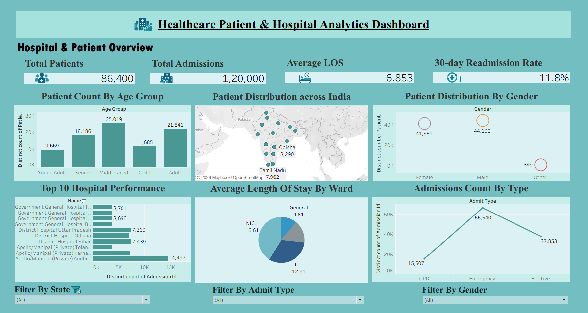
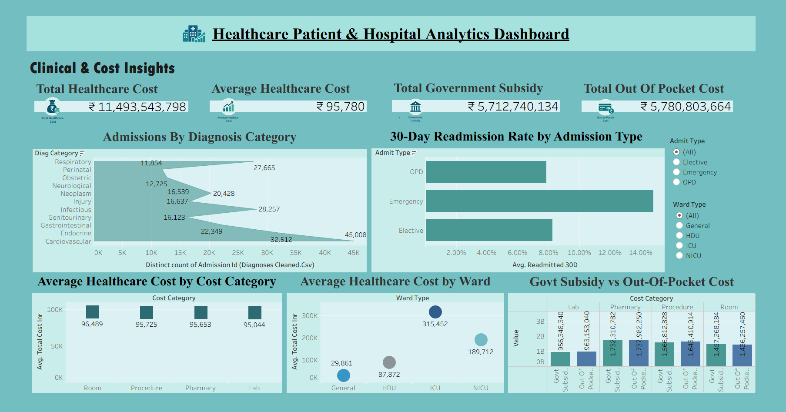

# Healthcare Patient & Hospital Analytics Dashboard

A healthcare analytics project using Python, Pandas, Jupyter Notebook, and Tableau to clean, analyze, and visualize healthcare data.

## Project Overview

This project explores healthcare data to understand patient demographics, hospital admissions, diagnoses, hospital performance, patient outcomes, and healthcare costs. Python and Pandas were used to clean and prepare datasets before developing interactive visualizations in Tableau.

## Project Workflow

1. **Data Cleaning:** Used Python and Pandas to inspect, clean, and prepare healthcare datasets.
2. **Data Preparation:** Saved the cleaned datasets as CSV files for further analysis.
3. **Data Analysis:** Explored healthcare data using Jupyter Notebooks.
4. **Data Visualization:** Developed Tableau dashboards to present key patterns and insights.

## Dashboard Analysis

The dashboards cover the following areas:

- Patient demographics by age group and gender
- Hospital admissions by admission type
- Length of stay by ward
- Hospital performance analysis
- Diagnosis category distribution
- Patient readmissions and outcomes
- Healthcare costs and billing analysis
- Geographic distribution of hospitals in India

## Dashboard Previews

### Dashboard 1

### Dashboard 2

## Tools and Technologies

- **Python** – Data cleaning and preparation
- **Pandas** – Data manipulation and analysis
- **Jupyter Notebook** – Data-cleaning workflow
- **Tableau** – Dashboard development and visualization
- **CSV** – Prepared datasets

## Project Files

The `Data/` folder contains Jupyter Notebooks and cleaned CSV datasets for five categories:

| Category | Notebook | Cleaned Dataset |
|---|---|---|
| Admissions | `admissions.ipynb` | `admissions_cleaned.csv` |
| Billing | `billing.ipynb` | `billing_cleaned.csv` |
| Diagnoses | `diagnoses.ipynb` | `diagnoses_cleaned.csv` |
| Hospitals | `hospitals.ipynb` | `hospitals_cleaned.csv` |
| Patients | `patients.ipynb` | `patients_cleaned.csv` |

Additional files:

- `Healthcare_Patient_Hospital_Analytics.twbx` – Packaged Tableau workbook
- `Dashboard-1.png` – Dashboard preview
- `Dashboard-2.png` – Dashboard preview

## Skills Demonstrated

- Healthcare data cleaning and preparation
- Exploratory data analysis
- Data manipulation using Python and Pandas
- Healthcare KPI and trend analysis
- Data visualization and dashboard development
- Communicating analytical findings through visualizations

## Project Objective

To apply data cleaning, analysis, and visualization techniques to healthcare datasets and present meaningful information about patients, hospitals, treatments, and costs.
